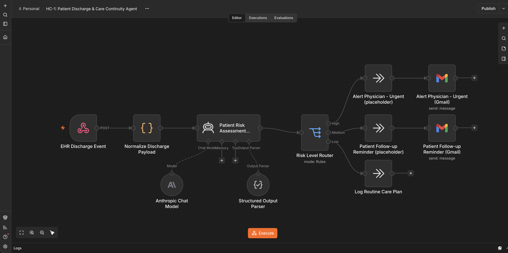
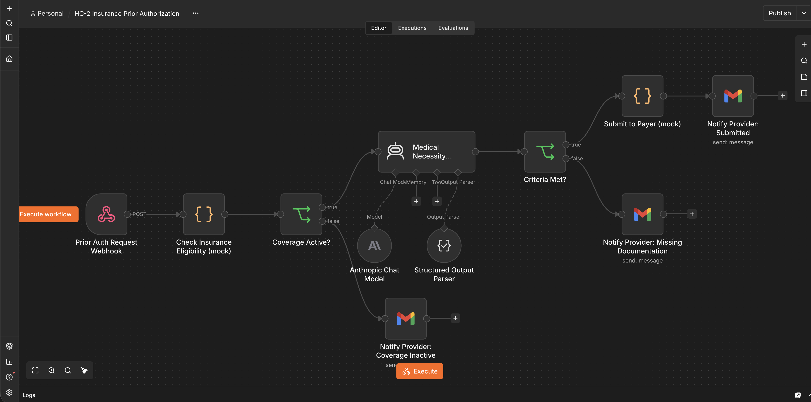
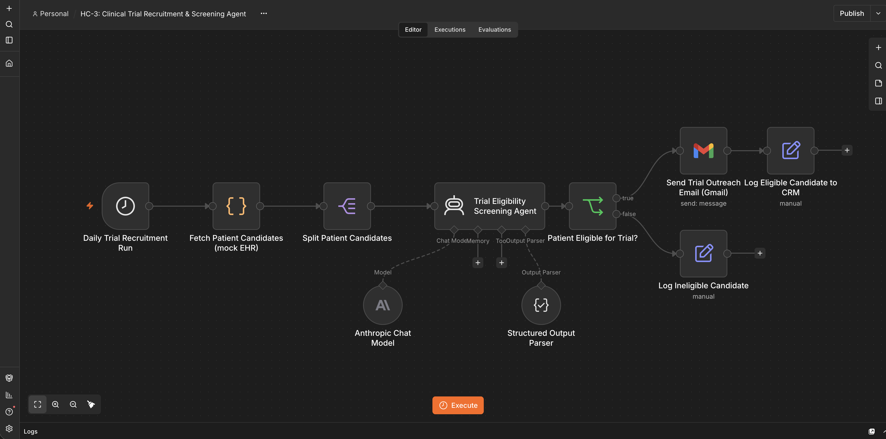
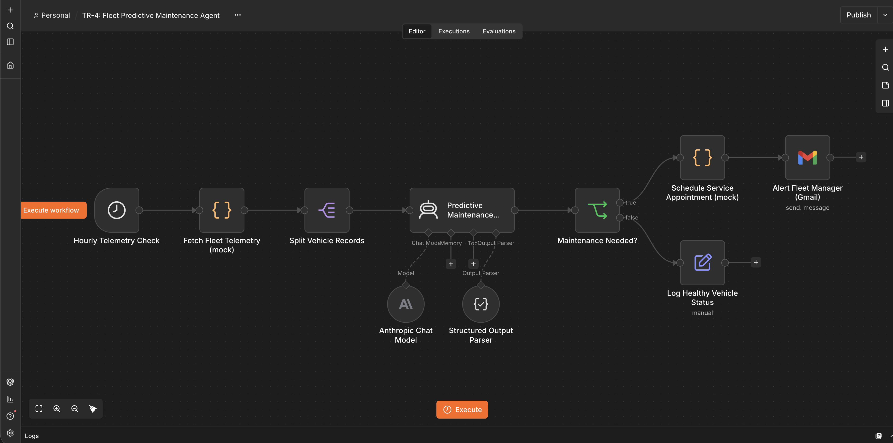
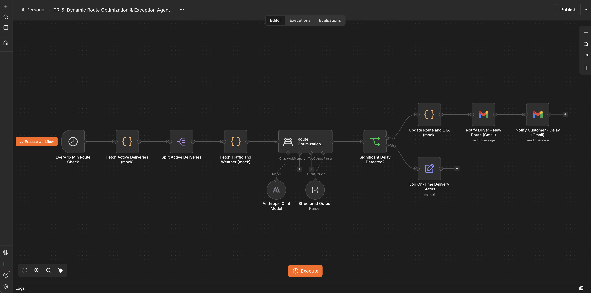
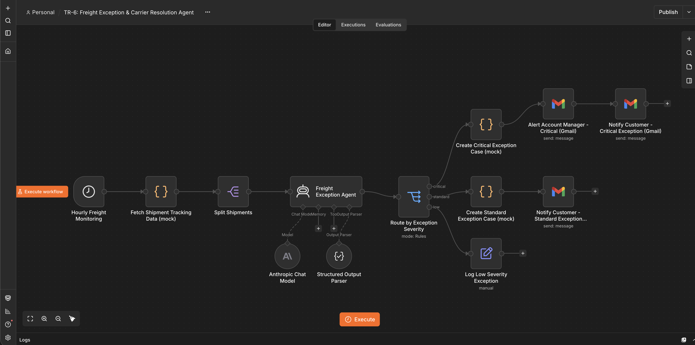

<div align="center">

# AI Agent Portfolio

### Built by Mythri Potluri

[](https://www.linkedin.com/in/mythripotluri1/)
[](https://mythrip11.github.io/ai-agent-portfolio/)
[](https://github.com/mythrip11)
[](mailto:mythrip11@gmail.com)
[]()


</div>

---

## What This Is

I build AI agents that do the work humans shouldn't have to.

This portfolio shows 9 workflow agents built on **n8n** and **Claude**, each one aimed at a real operational problem in an industry where AI adoption is still early: healthcare, transportation, and construction.

Every workflow was built, imported, run, and exported from a local n8n instance, and tested end to end with fictional data. The AI decision step and the Gmail notifications are real. The source and destination systems (EHR, telematics, ERP, CRM and similar) are mock Code nodes, so no real patient, customer, or company data is involved. To connect a real system, swap the mock node for an HTTP Request node.

---

## The Agents

### Healthcare

| Agent | What It Does | Trigger | Workflow |
|-------|-------------|---------|----------|
| **HC-1** Patient Discharge & Care Continuity | Fires when a patient is discharged from hospital. Claude scores their readmission risk and routes the case by risk level, with an urgent email to the physician for high-risk patients and a follow-up reminder for medium-risk ones. | Webhook | [View JSON](https://github.com/mythrip11/ai-agent-portfolio/blob/main/workflows/healthcare/HC-1_patient-discharge-care-continuity.json) |
| **HC-2** Insurance Prior Authorization | Takes an incoming auth request, checks insurance eligibility, has Claude evaluate medical necessity against the clinical notes, and submits to the payer (a mock step in the demo) when criteria are met. Requests with missing documentation get an email listing exactly what is needed. | Webhook | [View JSON](https://github.com/mythrip11/ai-agent-portfolio/blob/main/workflows/healthcare/HC-2_insurance-prior-authorization.json) |
| **HC-3** Clinical Trial Recruitment | Runs every morning and has Claude screen a list of patients against clinical trial criteria. Eligible patients get a personalized outreach email, and every result is logged. | Daily Schedule | [View JSON](https://github.com/mythrip11/ai-agent-portfolio/blob/main/workflows/healthcare/HC-3_clinical-trial-recruitment.json) |

### Transportation

| Agent | What It Does | Trigger | Workflow |
|-------|-------------|---------|----------|
| **TR-4** Fleet Predictive Maintenance | Pulls telematics data every hour for every vehicle in the fleet (mock data in the demo). Claude reads the sensor readings and fault codes, flags anything that looks like an upcoming failure, and books a service appointment and alerts the fleet manager by email before the truck breaks down on the road. | Hourly Schedule | [View JSON](https://github.com/mythrip11/ai-agent-portfolio/blob/main/workflows/transportation/TR-4_fleet-predictive-maintenance.json) |
| **TR-5** Dynamic Route Optimization | Checks every active delivery every 15 minutes against traffic and weather conditions (mock data in the demo). When Claude detects a significant delay, it suggests the best alternate route, updates the driver, and notifies the customer before they start calling in. | 15-Min Schedule | [View JSON](https://github.com/mythrip11/ai-agent-portfolio/blob/main/workflows/transportation/TR-5_dynamic-route-optimization.json) |
| **TR-6** Freight Exception Management | Checks every in-transit shipment with an exception every hour. Claude classifies the severity as critical, standard, or low. Critical cases get a case opened and the account manager emailed in the same run, standard cases notify the customer, and low-severity ones are logged. | Hourly Schedule | [View JSON](https://github.com/mythrip11/ai-agent-portfolio/blob/main/workflows/transportation/TR-6_freight-exception-management.json) |

### Construction

| Agent | What It Does | Trigger | Workflow |
|-------|-------------|---------|----------|
| **C-7** Site Safety & OSHA Reporting | Reads each day's site inspection reports and checks every violation against OSHA construction safety standards using Claude. Files an incident report (a mock step in the demo) for reportable findings and emails the project manager a corrective action plan. | Daily Schedule | [View JSON](https://github.com/mythrip11/ai-agent-portfolio/blob/main/workflows/construction/C-7_site-safety-osha-reporting.json) |
| **C-8** Subcontractor Invoice Reconciliation | Pulls pending invoices, fetches the matching contract Schedule of Values, and asks Claude to verify billed progress against actual progress, retainage, insurance, and lien waivers. Approved invoices get a payment voucher, and overbilled or incomplete ones are flagged back to the subcontractor. | Weekly Schedule | [View JSON](https://github.com/mythrip11/ai-agent-portfolio/blob/main/workflows/construction/C-8_subcontractor-invoice-reconciliation.json) |
| **C-9** Material Procurement & Supply Forecasting | Runs every morning, cross-references upcoming material needs against current inventory and supplier lead times with Claude, and creates purchase orders (mock) and alerts the project manager when a critical shortage is detected. Projects that are fully covered get a daily summary. | Daily Schedule | [View JSON](https://github.com/mythrip11/ai-agent-portfolio/blob/main/workflows/construction/C-9_material-procurement-supply-forecasting.json) |

---

## Workflow Gallery

Each agent is a real n8n workflow, imported, run, and exported from my local n8n instance. These are the canvases as built. Test data is fictional, and the CRM, EHR, ERP and similar systems are mock steps.

### Healthcare

| HC-1 Patient Discharge | HC-2 Prior Authorization | HC-3 Trial Recruitment |
|---|---|---|
|  |  |  |

### Transportation

| TR-4 Fleet Maintenance | TR-5 Route Optimization | TR-6 Freight Exceptions |
|---|---|---|
|  |  |  |

### Construction

| C-7 Site Safety and OSHA | C-8 Invoice Reconciliation | C-9 Material Procurement |
|---|---|---|
|  |  |  |

---

## How Each Agent Works

Every agent follows the same general pattern:

```
Trigger (Webhook or Schedule)
        |
  Fetch Data from Source System (mock)
        |
  Split into One Item per Record
        |
  Claude Makes the Decision
        |
  Route Based on Result
  /               \
Critical         Routine
  |                 |
Alert Team       Log and Continue
(Gmail + mock)   (Gmail summary or log)
```

The key step is the Claude agent node. Instead of writing hundreds of rules and if/else conditions, I give the model the context it needs (the data, the business rules, the desired output format) and let it make the call. The reply is turned into clean fields, using n8n's Structured Output Parser in most workflows and a small Code node that parses the JSON reply in the two newest ones (C-8 and C-9), so downstream nodes can route and act on it.

---

## Tech Stack

| Layer | Tool |
|-------|------|
| Workflow Orchestration | n8n |
| AI Decision Engine | Anthropic Claude via the n8n LangChain Agent node |
| Structured Output | n8n Structured Output Parser, or JSON parsed in a Code node |
| Notifications | Gmail (OAuth2) |
| Source Systems | Mock Code nodes with fictional data (swap for HTTP Request nodes to connect real systems) |
| Portfolio UI | Streamlit + custom CSS |
| Hosting | GitHub Pages + Streamlit Community Cloud |

---

## Repository Layout

```
ai-agent-portfolio/
  index.html, app.py, requirements.txt   the portfolio site (static page + Streamlit app)
  screenshots/                           n8n canvas screenshot for each workflow
  workflows/
    healthcare/       HC-1, HC-2, HC-3 (JSON + README)
    transportation/   TR-4, TR-5, TR-6 (JSON + README)
    construction/     C-7, C-8, C-9 (JSON + README)
```

- [workflows/healthcare](workflows/healthcare): HC-1, HC-2, HC-3
- [workflows/transportation](workflows/transportation): TR-4, TR-5, TR-6
- [workflows/construction](workflows/construction): C-7, C-8, C-9

Each folder has the importable n8n workflow JSON files and a README with setup steps.

---

## Live Portfolio

The portfolio has two live versions:

- **GitHub Pages (static):** [mythrip11.github.io/ai-agent-portfolio](https://mythrip11.github.io/ai-agent-portfolio/) — pure HTML/CSS/JS, no server required
- **Streamlit app:** deploy via [share.streamlit.io](https://share.streamlit.io) for the full Python version

---

## Run This Portfolio App Locally

```bash
git clone https://github.com/mythrip11/ai-agent-portfolio.git
cd ai-agent-portfolio
pip install streamlit
streamlit run app.py
```

The app opens at `http://localhost:8501`.

Or open `index.html` directly in any browser — no server needed.

---

## Deploy Your Own Copy

**GitHub Pages (recommended — zero config):**

1. Push this repo to GitHub
2. Go to repo **Settings → Pages**
3. Set Source to **Deploy from branch: main / root**
4. Click **Save** — live in ~60 seconds at `https://your-username.github.io/ai-agent-portfolio/`

**Streamlit Community Cloud:**

1. Fork this repo to your GitHub account
2. Go to [share.streamlit.io](https://share.streamlit.io) and sign in with GitHub
3. Click **New app** and select your fork
4. Set **Main file path** to `app.py`
5. Click **Deploy**

---

## About Me

I'm an AI Engineer based in New York City focused on building practical workflow automation. I specialize in industries where AI adoption is still early — healthcare, logistics, construction — because that's where the manual work is heaviest and the wins from automation are the biggest.

If you're a company with a repetitive operational process that your team is doing by hand, I build the agent that takes it off their plate.

**Get in touch:**
- Email: [mythrip11@gmail.com](mailto:mythrip11@gmail.com)
- LinkedIn: [linkedin.com/in/mythripotluri1](https://www.linkedin.com/in/mythripotluri1/)
- Portfolio: [mythrip11.github.io/ai-agent-portfolio](https://mythrip11.github.io/ai-agent-portfolio/)

---

<div align="center">
Built with n8n + Claude &nbsp;·&nbsp; New York City, New York
</div>
