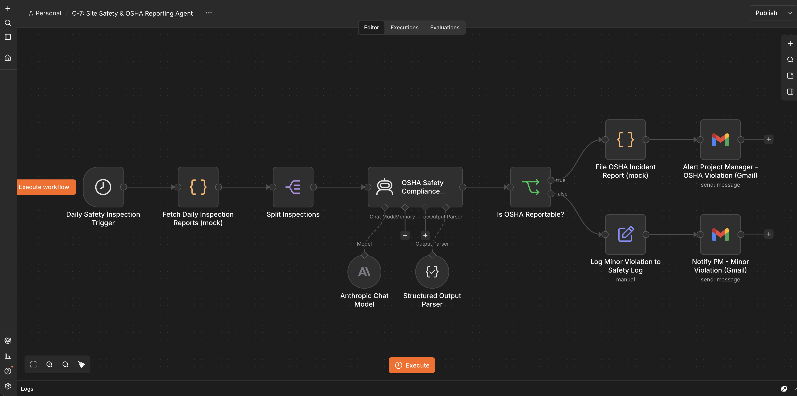
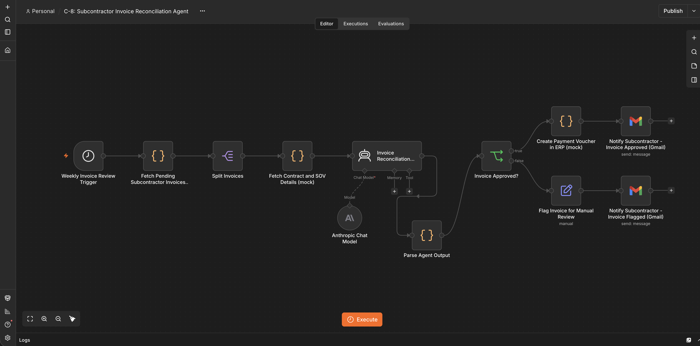
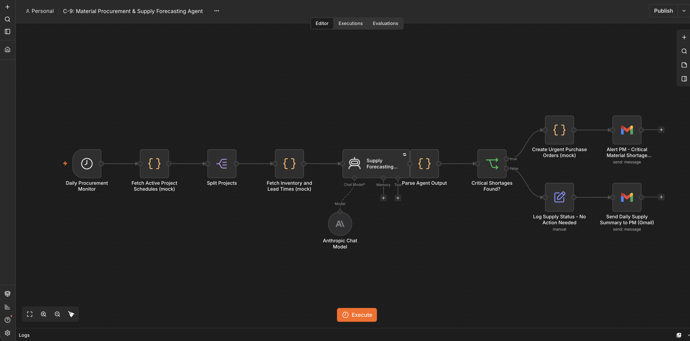

# Construction AI Agents

> 3 n8n workflow agents for OSHA safety compliance, subcontractor invoice reconciliation, and material procurement forecasting. Each one was built, run, and exported from a local n8n instance and tested end to end with fictional data.


---

## ✨ Agents

### C-7: Site Safety Compliance & OSHA Reporting
**Trigger:** Schedule → runs daily at 7:00 AM

> **Problem:** Contractors collect many site inspection reports every day, and deciding which findings are OSHA-reportable, filing them, and assigning corrective actions is manual and easy to get wrong or delay.
> **Built:** A daily agent that reads inspection reports (mock data in the demo) and has Claude decide whether each finding is OSHA-reportable, returning the violation type, the relevant OSHA standard area, a severity, and corrective actions.
> **Outcome:** Reportable findings get a mock incident report and an alert email to the project manager with the corrective actions. Minor findings are logged and the project manager is notified by email.


*Daily schedule, mock inspection reports, Claude OSHA review, then incident filing or minor-violation logging.*

```
Daily Scheduler
      ↓
Fetch Inspection Reports (mock)
      ↓
Split into One Report per Item
      ↓
Claude Reviews vs OSHA Standards
      ↓
  OSHA Reportable?
   Yes           No
    ↓             ↓
File OSHA     Log Minor
Report (mock) Violation
    ↓             ↓
Gmail Alert   Gmail Note
to PM         to PM
```

✅ Classifies each finding as reportable or minor, with a severity
✅ Files an incident report (mock) for reportable findings
✅ Emails the project manager a corrective action plan

**Where this pattern applies:**
- General contractors: triage daily inspection findings across many project sites
- Safety teams: flag fall protection, excavation, and electrical hazards for same-day action
- Project platforms: pull inspection data from a safety system and file reports automatically

**n8n:** https://github.com/mythrip11/ai-agent-portfolio/blob/main/workflows/construction/C-7_site-safety-osha-reporting.json

---

### C-8: Subcontractor Invoice Reconciliation & Payment
**Trigger:** Schedule → runs weekly (Monday, 8:00 AM)

> **Problem:** Finance teams check subcontractor invoices against the contract Schedule of Values by hand, which is slow and lets overbilling and missing compliance documents slip through.
> **Built:** A weekly agent that reads pending invoices and the matching contract data (mock ERP data in the demo) and has Claude compare billed progress to actual progress, check insurance and lien waiver status, and calculate retainage.
> **Outcome:** Approved invoices get a mock payment voucher with retainage withheld and an approval email to the subcontractor. Overbilled or incomplete invoices are flagged, and the subcontractor gets an email listing each discrepancy.


*Weekly schedule, mock invoices and contract data, Claude reconciliation, then payment voucher or flagged-invoice notice.*

```
Weekly Scheduler
      ↓
Fetch Pending Invoices (mock ERP)
      ↓
Split into One Invoice per Item
      ↓
Fetch Contract + SOV Details (mock)
      ↓
Claude Reconciles Billed vs Actual
+ Checks Insurance and Lien Waiver
      ↓
Parse JSON Reply
      ↓
  Approved?
  Yes      No
   ↓        ↓
Create    Flag for
Payment   Review
Voucher   (mock)
(mock)       ↓
   ↓      Gmail Sub
Gmail Sub (discrepancies)
(approved)
```

✅ Compares each invoice line to actual progress on the contract Schedule of Values
✅ Calculates retainage on approved invoices
✅ Flags lapsed insurance and missing lien waivers before payment

A small Code node parses Claude's JSON reply, and if the reply is ever empty or unreadable it routes the invoice to manual review instead of failing the run.

**Where this pattern applies:**
- Construction finance teams: reconcile subcontractor pay applications against the contract
- Project controls: catch overbilling and missing compliance documents before payment
- ERP integrations: push approved vouchers to an accounting system

**n8n:** https://github.com/mythrip11/ai-agent-portfolio/blob/main/workflows/construction/C-8_subcontractor-invoice-reconciliation.json

---

### C-9: Material Procurement & Supply Forecasting
**Trigger:** Schedule → runs daily at 6:00 AM

> **Problem:** Material shortages are often discovered only when a crew shows up and the material is not on site, which stalls work.
> **Built:** A daily agent that reads upcoming material needs for each project, adds on-hand stock and supplier lead times (mock data in the demo), and has Claude decide which shortages are critical. A shortage is critical when an order placed today would arrive after the material is needed.
> **Outcome:** Projects with a critical shortage get a mock purchase order and an alert email to the project manager listing the order lines. Fully covered projects are logged and the project manager gets a daily summary email.


*Daily schedule, mock schedules and inventory, Claude shortage forecast, then purchase orders or a daily summary.*

```
Daily Scheduler
      ↓
Fetch Project Schedules (mock)
      ↓
Split into One Project per Item
      ↓
Fetch Inventory + Lead Times (mock)
      ↓
Claude Compares Needs vs Stock + Lead Times
      ↓
Parse JSON Reply
      ↓
  Critical Shortage?
   Yes           No
    ↓             ↓
Create Urgent  Log, then
Purchase Orders  Daily Summary
(mock)         to PM (Gmail)
    ↓
Gmail Alert
to PM
```

✅ Compares upcoming material needs against stock for every project
✅ Takes supplier lead times into account
✅ Creates urgent purchase orders (mock) and alerts the project manager

A small Code node parses Claude's JSON reply, with the same manual-review fallback as C-8.

**Where this pattern applies:**
- General contractors: prevent steel, concrete, and window shortages on fast-moving projects
- Procurement teams: run a daily check across every active project
- Project and ERP platforms: pull schedules from one system and push purchase orders to another

**n8n:** https://github.com/mythrip11/ai-agent-portfolio/blob/main/workflows/construction/C-9_material-procurement-supply-forecasting.json

---

## 🚀 Quick Start

### Prerequisites
- An n8n instance (self-hosted, for example `localhost:5678`, or n8n Cloud)
- An Anthropic API key (Claude)
- Gmail OAuth2 credentials

### Setup (all three workflows)
1. In n8n, go to **Workflows → Import from File** and choose the JSON file.
2. Attach your own **Anthropic** and **Gmail OAuth2** credentials to the model and Gmail nodes.
3. Change the recipient address in the Gmail nodes to your own.
4. Click **Execute workflow**. Use fictional data only.

### What each workflow contains
- **C-7** (`C-7_site-safety-osha-reporting.json`): daily schedule, a mock safety platform node with 5 fictional inspection reports, a Claude agent with structured output, a mock OSHA filing node, and Gmail notices.
- **C-8** (`C-8_subcontractor-invoice-reconciliation.json`): weekly schedule, a mock ERP node with 4 fictional invoices, a mock contract lookup, a Claude agent, a parse node, a mock payment voucher, and Gmail notices.
- **C-9** (`C-9_material-procurement-supply-forecasting.json`): daily schedule, mock project schedules (4 fictional projects), a mock inventory and lead-time lookup, a Claude agent, a parse node, mock purchase orders, and Gmail notices.

### Credentials

| Agent | Credentials |
|-------|-------------|
| C-7   | Anthropic · Gmail |
| C-8   | Anthropic · Gmail |
| C-9   | Anthropic · Gmail |

The safety platform, ERP, project, inventory, and procurement steps are mock Code nodes with fictional data. To connect real systems, replace them with HTTP Request nodes.

---

## 🧑‍💻 Author
**Mythri Potluri** · GitHub: [@mythrip11](https://github.com/mythrip11)

## 📄 License
MIT

[← Back to the portfolio](../../README.md)
